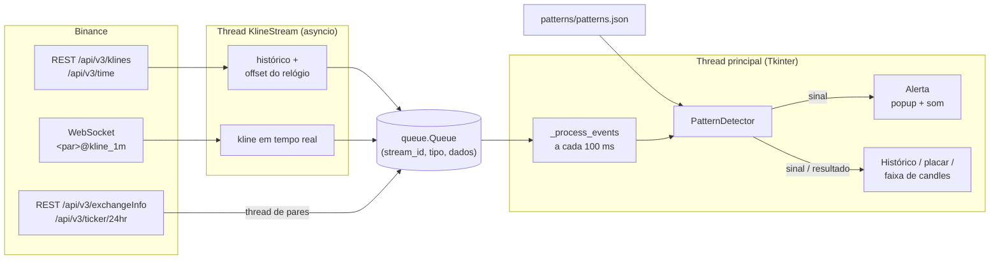
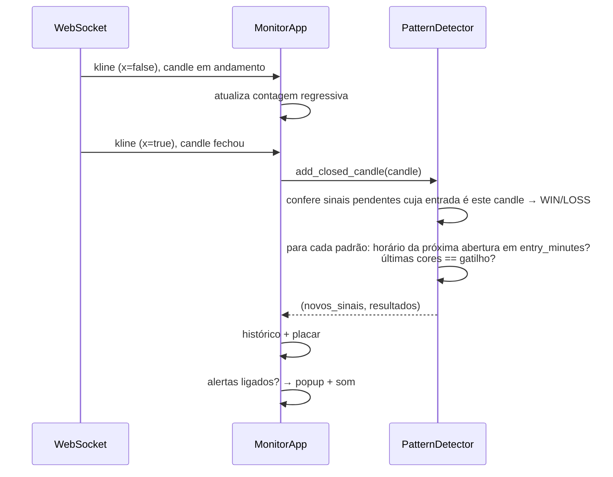

# Binance Monitor: monitor de padrões para opções binárias

Monitor com interface gráfica que acompanha um par da Binance em tempo real, procura sequências de candles
definidas em `patterns/patterns.json` e gera um alerta de **COMPRA (CALL)** ou **VENDA (PUT)** quando um padrão
se forma.

> O monitor só **sinaliza**: não opera, não envia ordens e não precisa de chave de API. Ele usa apenas os
> endpoints públicos de dados de mercado da Binance.

---

## Sumário

1. [Instalação](#instalação)
2. [Como usar](#como-usar)
3. [Padrões](#padrões)
4. [Arquitetura](#arquitetura)
5. [Detalhes de funcionamento](#detalhes-de-funcionamento)
6. [Configuração](#configuração)
7. [Solução de problemas](#solução-de-problemas)

---

## Instalação

Requisitos:

- Python 3.12 ou mais recente
- Tkinter (faz parte da biblioteca padrão, mas em algumas distribuições Linux é um pacote separado)
- Acesso à internet (`api.binance.com` e `stream.binance.com:9443`)

```bash
# Linux (Debian/Ubuntu): Tkinter, caso ainda não esteja instalado
sudo apt install python3-tk

python3 -m venv .venv
.venv/bin/pip install -r requiriments.txt
```

As dependências usadas pelo monitor são `requests` (REST) e `websockets` (tempo real).

## Como usar

Rode **a partir da raiz do projeto**, como módulo (`-m`), para que os imports de `core/` funcionem:

```bash
.venv/bin/python -m binance.monitor_patterns
```

```
┌──────────────────────────────────────────────────────────────────────┐
│ Par: [BTC/USDT ▾] Tempo: [1m ▾] [Iniciar procura] [x] Alertas [x] Som│
│ Conectado em BTC/USDT (1m)               Candle atual fecha em 18s   │
│ ┌ Ultimos candles fechados ────────────────────────────────────────┐ │
│ │ ■ ■ ■ ■ ■ ■ ■ ■ ■ ■ ■ ■ ■ ■ ■ ■ ■ ■ ■ ■                          │ │
│ └──────────────────────────────────────────────────────────────────┘ │
│ ┌ Padroes carregados (1m) ─────────────────────────────────────────┐ │
│ │ Padrao 1 - CALL:  R G G R R R G R  ->  COMPRA (CALL) | ... 2/7   │ │
│ └──────────────────────────────────────────────────────────────────┘ │
│ Sinais: 3   Win: 2   Loss: 1                                         │
│ [12:08:39] SINAL: VENDA (PUT) em BTC/USDT | entrada 12:12 | Padrao 2 │
└──────────────────────────────────────────────────────────────────────┘
```

| Controle | O que faz |
|---|---|
| **Par** | Escolhe o ativo. A lista traz **somente os pares ativos**: SPOT, em negociação (`TRADING`) e com pelo menos um negócio nas últimas 24h. Pares fora da lista são recusados. A lista é atualizada a cada 10 minutos. Os nomes aparecem como na Binance (`BTC/USDT`). Digite para filtrar (ex.: `BRL`); a busca aceita o nome com ou sem barra e em minúsculas (`btcusdt`, `BTC/USDT`). Use Enter ou selecione um item. Trocar o par com a procura ligada reinicia o monitoramento no novo par. |
| **Tempo** | Tempo gráfico do candle: `1m`, `3m`, `5m`, `15m`, `30m` ou `1h`. Começa no `interval` do `patterns.json`. Trocar o tempo com a procura ligada reinicia o monitoramento. A regra de horário (`entry_minutes`, o "2/7") só vale no tempo do JSON; nos outros, os padrões são procurados só pelas cores, e a lista de padrões avisa isso. |
| **Iniciar / Parar procura** | Liga e desliga a conexão em tempo real e a busca pelos padrões. Com a procura parada, nada é monitorado. |
| **Alertas ativos** | Ligado: cada padrão encontrado abre um popup verde (COMPRA) ou vermelho (VENDA), que fica por cima das outras janelas e fecha sozinho após 30 s. Desligado: o sinal só aparece no histórico. |
| **Som** | Toca o aviso sonoro (3 bipes) junto com o popup. Só tem efeito com os alertas ligados. |
| **Últimos candles fechados** | Os últimos 20 candles fechados como quadrados coloridos (verde, vermelho ou cinza para doji), do mais antigo para o mais recente. |
| **Candle atual fecha em** | Contagem regressiva até o fechamento do candle em andamento, pelo relógio do servidor da Binance. |
| **Sinais / Win / Loss** | Placar da sessão. Quando o candle de entrada fecha, o sinal é conferido: WIN se a cor bater com a direção indicada, LOSS caso contrário. |
| **Histórico** | Todos os eventos com horário: conexão, sinais, resultados e erros. |

### Fluxo típico

1. Abra o monitor e espere a mensagem `N pares ativos`.
2. Escolha o par (ex.: `BTC/USDT`, `ETH/BRL`) e o tempo do candle (ex.: `1m`).
3. Clique em **Iniciar procura**. O status muda para `Conectado em <PAR> (<tempo>)`.
4. Quando os 8 candles de gatilho de um padrão fecham no horário certo, o alerta aparece **antes** de o
   candle de entrada abrir: faça a entrada no candle indicado (`entrada HH:MM`).
5. Quando o candle de entrada fecha, o histórico mostra o resultado (WIN/LOSS).

## Padrões

Os padrões vêm das imagens em `patterns/` e estão descritos em `patterns/patterns.json`. Cada padrão tem 9
candles: os **8 primeiros são o gatilho** e o **9º é a entrada**, e a cor dele define a direção.

| Padrão | Imagem | Gatilho (candles 1 a 8) | Entrada (candle 9) |
|---|---|---|---|
| 1 | `WhatsApp Image ... 9.57.39 AM.jpeg` | R G G R R R G R | G → COMPRA (CALL) |
| 2 | `WhatsApp Image ... 9.57.39 AM (1).jpeg` | G R R G G G R G | R → VENDA (PUT) |
| 3 | `WhatsApp Image ... 9.57.40 AM.jpeg` | G R R G R R G R | G → COMPRA (CALL) |
| 4 | `WhatsApp Image ... 9.57.40 AM (1).jpeg` | R G G R G G R G | R → VENDA (PUT) |

`G` = candle verde (fechamento > abertura), `R` = candle vermelho (fechamento < abertura).

### Restrição de horário (2/7)

Nas imagens, o candle 4 está marcado com **2/7** e o candle 9 com **7/2**. O monitor interpreta isso como
horário no gráfico de 1 minuto: o candle 4 abre num minuto terminado em 2 ou 7 e, cinco candles depois, a
entrada abre no outro (7 ou 2).

```
candle:   1     2     3     4     5     6     7     8     9
minuto: 10:59 11:00 11:01 11:02 11:03 11:04 11:05 11:06 11:07
                              ▲                             ▲
                             "2"                    entrada "7"
```

No JSON, isso é o campo `entry_minutes: [2, 7]`, que vale para o **minuto de abertura do candle de entrada**.

A regra só é aplicada quando o **Tempo** selecionado é igual ao `interval` do JSON (`1m`). Em outros tempos
ela não faria sentido: no `5m`, por exemplo, os candles abrem em minutos terminados em 0 ou 5 e nunca
bateriam com 2/7. Por isso, fora do `1m`, o monitor procura os padrões só pelas cores.

### Formato de `patterns/patterns.json`

```json
{
    "interval": "1m",
    "patterns": [
        {
            "name": "Padrao 1 - CALL",
            "image": "WhatsApp Image 2026-09-25 at 9.57.39 AM.jpeg",
            "candles": "R G G R R R G R G",
            "entry_minutes": [2, 7]
        }
    ]
}
```

| Campo | Obrigatório | Descrição |
|---|---|---|
| `interval` | não (padrão `1m`) | Tempo gráfico em que os padrões foram definidos (`1m`, `3m`, `5m`, `15m`, `30m` ou `1h`). É o tempo já selecionado ao abrir e o único em que `entry_minutes` é aplicado. |
| `name` | sim | Nome exibido no histórico e no alerta. |
| `candles` | sim | Sequência de `G`/`R`, separada por espaço ou vírgula. O último candle é a entrada; os anteriores, o gatilho. Pode ter qualquer tamanho a partir de 2. |
| `entry_minutes` | não | Último dígito do minuto em que o candle de entrada pode abrir. `[]` ou ausente = qualquer horário. |
| `image` | não | Só referência para a imagem de origem; o programa não lê o arquivo. |

Para **adicionar um padrão**, inclua uma nova entrada em `patterns` e reinicie o monitor. Se o arquivo tiver
erro (letra inválida, JSON malformado), o monitor mostra uma mensagem e não abre.

---

## Arquitetura

### Arquivos

```
binance_monitor/
├── binance/                          # monitor da Binance
│   ├── monitor_patterns.py           # GUI (Tkinter) + stream em tempo real (WebSocket)
│   ├── monitor_resquests_REST_v0.py  # Cliente REST: hora do servidor e candles históricos
│   └── README.md                     # este documento
├── core/                             # código compartilhado entre os monitores
│   └── pattern_detector.py           # Lógica dos padrões: carga do JSON, detecção, resultado
├── iqoption/                         # variação IQ Option (ver iqoption/README.md)
├── patterns/                         # compartilhado entre os monitores
│   ├── patterns.json                 # Definição dos padrões
│   └── *.jpeg                        # Imagens de referência dos padrões
└── requiriments.txt                  # Dependências
```

### Módulos

**`monitor_resquests_REST_v0.py`**: cliente REST (versão original do projeto, reaproveitada).

- `get_server_time_offset()`: diferença entre o relógio local e o da Binance (`/api/v3/time`).
- `get_candles(trade_config, time_offset)`: busca candles em `/api/v3/klines` e marca `is_closed`.
- `BinanceAPIError`: erro de API (par inexistente, limite de requisições etc.).

**`pattern_detector.py`**: regras de negócio, sem rede nem interface (dá para testar isoladamente).

- `load_patterns(path)`: lê e valida o JSON e devolve `(interval, [Pattern])`.
- `Pattern`: `name`, `trigger` (ex.: `'RGGRRRGR'`), `direction` (`'G'`/`'R'`), `entry_minutes`.
- `Signal`: padrão encontrado + `entry_open_time` (abertura do candle de entrada, em ms).
- `PatternDetector(patterns, interval, use_entry_minutes)`: guarda até 200 candles fechados, indexados por
  `open_time`. É recriado a cada início de procura, com o tempo selecionado; `use_entry_minutes` só é
  verdadeiro quando esse tempo é o `interval` do JSON.
  - `load_history(candles)`: carrega o histórico **sem** gerar sinais.
  - `add_closed_candle(candle)`: registra um candle fechado e devolve `(novos_sinais, resultados)`.
  - `last_colors(n)`: cores dos últimos `n` candles **consecutivos**.

**`monitor_patterns.py`**: aplicação.

- `KlineStream` (thread): roda um loop `asyncio` próprio, busca o histórico por REST, conecta ao WebSocket
  `<par>@kline_<intervalo>` e publica eventos numa fila. Reconecta sozinho com espera progressiva
  (1 s, 2 s, 4 s ... até 60 s).
- `MonitorApp`: janela Tkinter. Consome a fila a cada 100 ms, alimenta o `PatternDetector`, atualiza a tela e
  dispara os alertas.
- `get_symbols()`: pares ativos, carregados numa thread à parte. Cruza `/api/v3/exchangeInfo` (status
  `TRADING` e `isSpotTradingAllowed`) com `/api/v3/ticker/24hr` (pelo menos um negócio em 24h), para
  descartar pares que constam como em negociação mas estão parados.
- `_on_symbols_loaded()`: atualiza a lista, registra no histórico o que entrou e saiu e avisa se o par
  monitorado deixou de estar ativo. Também é usado pela variação IQ Option.

### Fluxo de dados



### Modelo de threads

O Tkinter só pode ser usado pela thread principal, então as threads de rede **nunca** mexem na interface:
elas só colocam eventos numa `queue.Queue`, que a GUI esvazia com `root.after(100, ...)`.

| Thread | Responsabilidade |
|---|---|
| Principal | Tkinter, `PatternDetector`, alertas, contagem regressiva (`_tick`, 1 s) |
| `KlineStream` | REST do histórico + WebSocket; uma por procura ativa |
| Carga de pares | Busca os pares ativos na abertura e a cada 10 minutos |

Eventos publicados na fila:

| Tipo | Origem | Conteúdo |
|---|---|---|
| `symbols` / `symbols_error` | carga de pares | lista de pares ou mensagem de erro |
| `history` | `KlineStream` | candles fechados recentes + offset do relógio |
| `kline` | `KlineStream` | candle atual (aberto) ou recém-fechado |
| `status` | `KlineStream` | conectado, reconectando, parado |
| `fatal` | `KlineStream` | erro da API da Binance; a procura é encerrada |

Cada `KlineStream` recebe um `stream_id` crescente. Ao parar a procura ou trocar de par, a thread antiga
recebe o pedido de parada, mas ainda pode entregar algumas mensagens. A GUI descarta qualquer evento cujo
`stream_id` não seja o da procura atual, o que evita misturar candles de pares ou tempos diferentes.

---

## Detalhes de funcionamento

### Detecção, candle a candle



Regras:

- **Só candles fechados contam.** O candle em andamento muda de cor até fechar; por isso a comparação usa
  apenas candles com `x = true` no WebSocket (ou `is_closed` no REST).
- **Sequência contínua.** O gatilho só é aceito se os candles forem consecutivos (`open_time` com diferença
  de exatamente um intervalo). Um buraco no histórico interrompe a sequência.
- **Doji não casa.** Um candle com abertura igual ao fechamento recebe a cor `D` e quebra qualquer padrão.
- **Sinal no momento certo.** O alerta sai no fechamento do último candle do gatilho, ou seja, antes da
  abertura do candle de entrada. O histórico carregado por REST **não** gera sinais, para não alertar uma
  entrada que já passou.
- **Sem duplicidade.** Se um candle já registrado chegar de novo (ex.: histórico recarregado após uma
  reconexão), ele é ignorado.
- **Horário.** Os horários são exibidos em `America/Sao_Paulo`. A regra de minuto (`entry_minutes`) não é
  afetada pelo fuso, porque os fusos usados têm deslocamento em horas inteiras.

### Reconexão

A Binance encerra conexões WebSocket periodicamente (no máximo a cada 24 h) e a rede pode cair. Em qualquer
falha de conexão, o `KlineStream`:

1. publica `Conexao perdida (...). Reconectando em Ns...`;
2. espera com backoff exponencial (até 60 s);
3. recarrega os últimos 30 candles por REST, preenchendo o que se perdeu;
4. reconecta ao WebSocket.

Erros da API (`BinanceAPIError`, como par inválido) não são tentados de novo: a procura para e o erro aparece
no histórico.

---

## Configuração

Constantes no topo de `monitor_patterns.py`:

| Constante | Padrão | Descrição |
|---|---|---|
| `DEFAULT_SYMBOL` | `BTC/USDT` | Par já preenchido ao abrir |
| `HISTORY_LIMIT` | `30` | Candles buscados por REST a cada (re)conexão |
| `ALERT_SECONDS` | `30` | Tempo até o popup de alerta fechar sozinho |
| `PATTERNS_FILE` | `patterns/patterns.json` | Arquivo de padrões |

O tempo do candle é escolhido na janela (**Tempo**). O campo `interval` do `patterns.json` define o tempo
inicial e o tempo em que a regra de horário vale. Para oferecer outros tempos da Binance (ex.: `2h`, `4h`,
`1d`), acrescente-os em `INTERVAL_MS`, no `core/pattern_detector.py`.

## Solução de problemas

| Sintoma | Causa provável / solução |
|---|---|
| `ModuleNotFoundError: No module named 'tkinter'` | Instale o Tkinter do sistema: `sudo apt install python3-tk`. |
| `Nao foi possivel carregar os pares` | Sem acesso a `api.binance.com`. A procura ainda funciona se você digitar o par, mas sem validação prévia. |
| `<PAR> nao esta disponivel na Binance (SPOT)` | Par digitado errado ou inativo. Use o filtro da lista. |
| `Conexao perdida ... Reconectando` em loop | Porta 9443 bloqueada por firewall/proxy, ou sem internet. |
| `Binance API error: ... 429/418` | Limite de requisições excedido; aguarde alguns minutos. |
| Nenhum sinal aparece | É o esperado na maior parte do tempo: o padrão exige 8 cores exatas **e** o minuto certo. Para testar, use `"entry_minutes": []` ou um padrão curto (ex.: `"G G G"`). Em tempos maiores (`15m`, `1h`), cada candle demora mais, então os sinais são bem mais raros. |
| Sem som no alerta | O bipe usa o sino do sistema (`bell`), que pode estar desativado no ambiente gráfico. |

### Testando o detector sem a Binance

```python
from datetime import datetime
from core.pattern_detector import PatternDetector, load_patterns, tz   # rodando da raiz do projeto

interval, patterns = load_patterns('patterns/patterns.json')
detector = PatternDetector(patterns, interval)

start = int(datetime(2026, 10, 19, 10, 59, tzinfo=tz).timestamp() * 1000)  # candle 4 = 11:02
for i, color in enumerate('RGGRRRGRG'):
    candle = {'open_time': start + i * 60_000, 'open': 1.0,
              'close': 1.1 if color == 'G' else 0.9, 'is_closed': True}
    signals, results = detector.add_closed_candle(candle)
    for s in signals:
        print('sinal:', s.pattern.name, s.label)        # após o 8º candle → COMPRA (CALL)
    for s, color, won in results:
        print('resultado:', 'WIN' if won else 'LOSS')   # após o 9º candle → WIN
```
