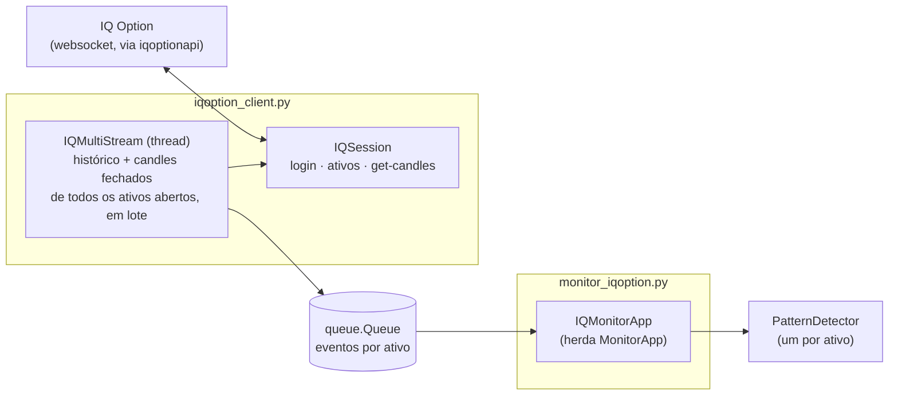

# Monitor de padrões: IQ Option

Monitor com interface gráfica que procura, em tempo real, as sequências de candles definidas em
`patterns/patterns.json` em **todos os ativos abertos** de um tipo da **IQ Option**. Quando um padrão se forma,
abre um popup verde com o ativo, o padrão e o horário da entrada, e registra a mesma mensagem no histórico.

> **Atenção**
> - A IQ Option **não tem API pública**. Este monitor usa a biblioteca não oficial
>   [`iqoptionapi`](https://github.com/Lu-Yi-Hsun/iqoptionapi), sem manutenção desde 2021. Ela pode parar
>   de funcionar a qualquer momento se a IQ Option mudar o protocolo.
> - É preciso entrar com **e-mail e senha da sua conta**. O uso de automações pode contrariar os termos de
>   uso da IQ Option; use por sua conta e risco (de preferência com a conta de treinamento).
> - A biblioteca conecta ao websocket da IQ Option **sem verificar o certificado SSL**.
> - O monitor só lê candles: não abre operações nem altera o saldo.

## Instalação

```bash
sudo apt install python3-tk                       # Linux, se o Tkinter não estiver instalado
python3 -m venv .venv
.venv/bin/pip install -r iqoption/requirements.txt
```

Isso instala a `iqoptionapi`, fixada num commit específico do GitHub, e a `websocket-client 0.56` que ela
exige.

## Como usar

Rode **a partir da raiz do projeto**, como módulo (`-m`):

```bash
.venv/bin/python -m iqoption.monitor_iqoption
```

Para não digitar as credenciais toda vez, você pode passá-las por variável de ambiente. Elas só servem para
preencher os campos; as credenciais nunca são gravadas em disco (as demais escolhas sim; veja
[Escolhas salvas](#escolhas-salvas-entre-uma-execução-e-outra)).

```bash
IQ_LOGIN='voce@email.com' IQ_PASSWORD='sua-senha' .venv/bin/python -m iqoption.monitor_iqoption
```

1. Preencha **E-mail** e **Senha** e clique em **Entrar** (ou pressione Enter no campo da senha).
2. Escolha o **Tipo** de ativo, como nas categorias da IQ Option: **Opcoes binarias** (padrão), **Blitz**,
   **Opcoes digitais**, **Forex**, **Criptomoedas** ou **CFD / Acoes** (ações, índices e commodities).
   Trocar o tipo encerra a procura em andamento e recarrega a lista. Se o ativo de um cartão não
   existir no novo tipo, o cartão passa para um ativo aberto ainda não usado.
3. Depois do login, o histórico mostra `N ativos abertos (<tipo>)`, e a lista de ativos dos cartões passa a mostrar
   **somente** os ativos abertos do tipo escolhido, com o nome como aparece na IQ Option (ex.: `EUR/USD`,
   `EUR/USD (OTC)`). A busca aceita variações: `EUR/USD`, `eurusd`, `EURUSD-OTC` e `eur/usd (otc)` encontram
   o ativo certo. Ativos fechados não aparecem e, se digitados, são recusados. A lista é atualizada a cada
   5 minutos, porque os mercados abrem e fecham (ex.: forex fecha no fim de semana e a versão OTC abre).
   Mudanças aparecem no histórico
   (`Lista atualizada: N ativos abertos (+x / -y)`), e se um ativo da tela fechar aparece o aviso
   `<ATIVO> deixou de estar ativo`.
4. Escolha quais ativos aparecem na tela: o botão **+** (ao lado do **Tipo**) adiciona um cartão, já
   preenchido com um ativo aberto que ainda não está na tela (o primeiro é `EUR/USD`), e o **✕** vermelho no
   canto superior direito do cartão o fecha. Não há limite de cartões. O ativo de cada cartão pode ser
   trocado no seu campo; o mesmo ativo não pode estar em dois cartões. **Os cartões só escolhem o que
   aparece na tela: a procura acompanha todos os ativos abertos do tipo**, com ou sem cartão.
5. Escolha o **Tempo** (`1m`, `5m`, `15m`, `30m` ou `1h`; a IQ Option não tem candle de 3m). Ele vale para
   todos os ativos.
6. Clique em **Iniciar procura**. A procura passa a acompanhar **todos os ativos abertos do tipo**
   (`Procura iniciada em todos os N ativos abertos (<tipo>)`), e um padrão em qualquer um deles gera o
   alerta, mesmo que o ativo não esteja na tela. Adicionar, fechar ou trocar cartões com a procura ligada não
   reinicia nada. Quando a lista de ativos é atualizada, os que abriram entram na procura e os que fecharam
   saem (`Procura: +x / -y ativos`). Se o ativo escolhido num cartão for inválido ou repetido, aparece um
   aviso e o cartão volta ao ativo anterior. Trocar o **Tempo** ou o **Tipo** reinicia a procura de todos.
7. Um padrão que já estava formado quando o ativo entrou na procura (ao iniciar, quando o ativo abre e
   entra na procura ou ao recarregar o histórico depois de uma reconexão) **gera alerta se o candle de entrada ainda estiver
   aberto**. Se a entrada já fechou, ele é ignorado.

Os demais controles:

| Controle | O que faz |
|---|---|
| **Filtro de minutos 2/7** | Fica em **Padrões carregados** e vem ligado. Ligado: em `1m`, os Padrões 1 a 4 só valem com o candle 4 em minuto final 2 ou 7 (candle 9 em 7 ou 2). Desligado: valem em qualquer horário. Pode ser trocado com a procura ligada, sem reiniciá-la, e a escolha fica salva. Não afeta os Padrões 5 e 6. |
| **Alertas ativos** | Ligado: cada padrão encontrado abre um popup verde com o ativo, o nome do padrão e o horário da entrada, que fica por cima das outras janelas e fecha sozinho após 30 s. Clicar no popup, fora do botão **Fechar alerta**, fecha-o, traz o monitor para a frente e abre o card do ativo; se o card já existir, mostra o que está aberto. Desligado: o sinal só aparece no histórico. |
| **Som** | Toca o aviso sonoro (3 bipes) junto com o popup. Só tem efeito com os alertas ligados. |
| **Candle atual fecha em** | Contagem regressiva até o fechamento do candle em andamento, pelo relógio do servidor da IQ Option. |
| **Histórico** | Eventos com horário: conexão e erros e, para cada padrão formado, a mesma mensagem do popup: `15:17:02 Gold/BRL \| Padrao 2 \| entrada 15:17`. O monitor não mostra resultados (WIN/LOSS) nem placar: só avisa os padrões formados (para medir o acerto, use o [backtest](#backtest-com-os-candles-da-iq-option)). |

### Alertas no tempo certo

- O alerta mostra o atraso quando chega mais de 3 s depois da abertura do candle de entrada:
  `EUR/USD | Padrao 1 | entrada 12:30 (atrasado 8s, fecha em 52s)`. Isso acontece, por exemplo, depois de uma
  reconexão ou quando a IQ Option demora a entregar o candle fechado.
- Se o candle de entrada **já fechou** quando o padrão chega (ex.: vários candles chegando juntos depois de
  uma queda de conexão), não há alerta: o histórico mostra `Padrao perdido (sem alerta): ... ja fechou, Ns
  atrasado`.
- Quando o candle recém-fechado ainda não veio, o ativo é consultado de novo a cada 0,5 s nos primeiros
  segundos (antes, a espera começava em 2 s), porque cada segundo de atraso come a entrada.

### Candle corrigido

Cada candle é conferido de novo no lote seguinte. Se a IQ Option mudou o preço depois (um tick atrasado), o
candle é trocado pela versão final. Se a cor mudou num ativo da tela, o histórico avisa
`candle 12:30 corrigido pela IQ Option: R -> G`.

### Escolhas salvas entre uma execução e outra

Ao fechar a janela, ao iniciar uma procura e ao adicionar, fechar ou trocar um cartão, o monitor grava em
`~/.config/monitor_padroes/iqoption.json` o **Tipo**, os ativos dos cartões na tela, o **Tempo**,
as opções **Alertas ativos** e **Som**, o tamanho da janela e se a procura
estava ligada. Ao abrir de novo, tudo volta como estava; o histórico avisa `Restaurados N cartao(oes)`.

- **E-mail e senha não são gravados.** Continue usando `IQ_LOGIN`/`IQ_PASSWORD` se não quiser digitá-los (`IQ_EMAIL` também é aceito no lugar de `IQ_LOGIN`).
- Se a procura estava ligada ao fechar, ela **é retomada sozinha** logo depois do login, assim que a lista
  de ativos chega.
- Se um ativo salvo não estiver aberto agora (ex.: forex no fim de semana), ele é trocado por um ativo
  aberto ainda não usado, com o aviso `Cartao <ativo>: nao esta aberto em <tipo> agora; trocado por ...`.
- Para usar outro arquivo, defina `IQ_SETTINGS_FILE=/caminho/arquivo.json`. Para voltar ao padrão, apague o
  arquivo. Um arquivo inválido é ignorado.

### Cartões dos ativos

Cada ativo na tela tem um cartão com:

- o campo do ativo, o **✕** para fechar o cartão, e a situação (`ao vivo`, `sem cotacao recente (ativo fechado?)` ou o erro);
- três grupos separados por uma linha horizontal: Padrões 1 a 4, Padrão 5 e Padrão 6;
- em cada grupo, a faixa dos últimos candles fechados, numerada como o gatilho e a entrada (1..8 e 9,
  1..12 e 13, 1..7 e 8), e o termômetro desses padrões (abaixo).

O cartão ganha borda vermelha quando algum padrão se forma nele. Os cartões se distribuem em tantas colunas
quantas couberem na largura da janela (um cartão precisa de cerca de 540 px) e se reorganizam ao
redimensionar. A área dos cartões cresce até 55% da altura da janela; acima disso aparece uma barra de
rolagem (também funciona a roda do mouse sobre os cartões). A contagem
regressiva e o histórico são únicos, com o nome do ativo em cada mensagem, e valem para todos os ativos da
procura. O título da área mostra `Ativos na tela (N) | procura em M ativos`. Se vários ativos
sinalizarem no mesmo candle, os alertas abrem em cascata para não se cobrirem. Avisos de erro de um ativo
(ex.: `sem cotacao recente`) só vão para o histórico quando o ativo está na tela.

### Termômetro dos padrões

Em cada cartão, uma linha por padrão mostra o quanto do gatilho (os candles antes da
entrada) já se formou nos últimos candles fechados:

- os quadrados do gatilho ficam preenchidos com a cor de cada candle já formado; o próximo candle esperado
  aparece com contorno tracejado na cor que precisa ter;
- a barra do termômetro enche e esquenta conforme o padrão avança (azul até 50%, amarelo até 75%, laranja
  depois) e mostra a porcentagem;
- o texto diz quantos candles faltam e o horário previsto da entrada; com o gatilho completo aparece
  `FORMADO: COMPRA (CALL)` / `VENDA (PUT)` com o horário da entrada (o próximo candle), ou
  `FORMADO: entrada HH:MM` nos padrões sem direção (5 e 6).

Conta o maior trecho final dos candles fechados que repete o início do gatilho
(`PatternDetector.pattern_progress`). Se um candle sai diferente do esperado, o termômetro cai para o
trecho que ainda serve (às vezes 0). Com regra de minuto valendo (Padrão 6 sempre; Padrões 1 a 4 com o filtro
ligado, em `1m`), só conta se a entrada prevista cair no minuto aceito; senão ele fica em 0%. O termômetro usa só candles fechados (a
IQ Option não envia o preço do candle em andamento).

## Padrões

Os padrões vêm das imagens em `patterns/` e estão descritos em `patterns/patterns.json`. Nos Padrões 1 a 4,
os **8 primeiros candles são o gatilho** e o **9º é a entrada**, e a cor dele define a direção. Nos Padrões 5
e 6, **todos os candles são o gatilho**, não há direção e o alerta sai no candle seguinte ao último.

| Padrão | Imagem | Gatilho | Alerta | Horário |
|---|---|---|---|---|
| 1 | `pattern_1.jpeg` | R G G R R R G R | candle 9: G → COMPRA (CALL) | filtro 2/7 (opcional) |
| 2 | `pattern_2.jpeg` | G R R G G G R G | candle 9: R → VENDA (PUT) | filtro 2/7 (opcional) |
| 3 | `pattern_3.jpeg` | G R R G R R G R | candle 9: G → COMPRA (CALL) | filtro 2/7 (opcional) |
| 4 | `pattern_4.jpeg` | R G G R G G R G | candle 9: R → VENDA (PUT) | filtro 2/7 (opcional) |
| 5 | `pattern_5.jpeg` | R G G R R R G R G G R R | candle 13, sem direção | qualquer |
| 6 | `pattern_6.jpeg` | R G G R R R G | candle 8, sem direção | candle 1 em minuto final 1 |

`G` = candle verde (fechamento > abertura), `R` = candle vermelho (fechamento < abertura).

### Restrição de horário

Os Padrões 1 a 5 usam o **Tempo** escolhido.

**Padrões 1 a 4: filtro 2/7, opcional.** Como marcam as imagens, o candle 4 abre em minuto final 2 ou 7, e o
candle 9, cinco minutos depois, em final 7 ou 2:

```
candle:   1     2     3     4     5     6     7     8     9
minuto: 10:59 11:00 11:01 11:02 11:03 11:04 11:05 11:06 11:07
                            ▲                             ▲
                           "2"                           "7"
```

O filtro só existe em `1m`: em `5m` os candles abrem em minutos 0 ou 5, então ali os padrões valem sempre.
Com o filtro desligado, valem em qualquer horário.

**Padrão 5: sem regra de horário.**

**Padrão 6: regra própria e fixa, que o filtro não afeta.** Ele é independente: é sempre
acompanhado em `1m`, qualquer que seja o **Tempo** (fora do `1m`, o monitor abre um segundo stream e o mostra
como `Padrao 6 (1m)` no cartão). Ele exige que o candle 1 abra num minuto terminado em 1; o candle 8, do
alerta, abre então num minuto terminado em 8:

```
candle:   1     2     3     4     5     6     7     8
minuto: 11:01 11:02 11:03 11:04 11:05 11:06 11:07 11:08
          ▲                                         ▲
         "1"                                 alerta "8"
```

No JSON, as regras ficam em `entry_minutes`, que vale para o **minuto de abertura do candle de entrada**:
`[7, 2]` nos Padrões 1 a 4 e `[8]` no Padrão 6.

### Formato de `patterns/patterns.json`

```json
{
    "interval": "1m",
    "patterns": [
        {
            "name": "Padrao 1",
            "image": "pattern_1.jpeg",
            "candles": "R G G R R R G R G",
            "entry_minutes": [7, 2],
            "minutes_candle": 4,
            "minutes_optional": true
        }
    ]
}
```

| Campo | Obrigatório | Descrição |
|---|---|---|
| `interval` | não (padrão `1m`) | Tempo gráfico em que os padrões foram definidos. É o tempo já selecionado ao abrir e o único em que o filtro de minutos é aplicado. |
| `name` | sim | Nome exibido no histórico e no alerta. |
| `candles` | sim | Sequência de `G`/`R`, separada por espaço ou vírgula. O último candle é a entrada; os anteriores, o gatilho. Pode ter qualquer tamanho a partir de 2. |
| `alert_only` | não (padrão `false`) | `true`: todos os candles são o gatilho, sem direção, e o alerta sai no candle seguinte ao último. Esses padrões ficam fora do backtest, que não tem como dar WIN/LOSS sem direção. |
| `interval` (no padrão) | não | Tempo fixo do padrão, independente do **Tempo** escolhido no monitor. Ausente = usa o **Tempo** escolhido. |
| `entry_minutes` | não | Último dígito do minuto em que o candle de entrada pode abrir. `[]` ou ausente = qualquer horário. |
| `minutes_candle` | não (padrão `1`) | Candle marcado na imagem. Só muda o texto da regra no painel, como `candle 4 em minutos final 2/7 e candle 9 em final 7/2`. |
| `minutes_optional` | não (padrão `false`) | `true`: a regra obedece ao **Filtro de minutos** do painel. `false`: `entry_minutes` vale sempre. |
| `image` | não | Só referência para a imagem de origem; o programa não lê o arquivo. |

Para **adicionar um padrão**, inclua uma nova entrada em `patterns` e reinicie o monitor. Se o arquivo tiver
erro (letra inválida, JSON malformado), o monitor mostra uma mensagem e não abre.

### Regras da detecção

- **Só candles fechados contam.** O candle em andamento muda de cor até fechar.
- **Sequência contínua.** O gatilho só é aceito se os candles forem consecutivos (`open_time` com diferença
  de exatamente um intervalo). Um buraco no histórico interrompe a sequência.
- **Doji não casa.** Um candle com abertura igual ao fechamento recebe a cor `D` e quebra qualquer padrão.
- **Sem duplicidade.** Se um candle já registrado chegar de novo (ex.: histórico recarregado após uma
  reconexão), ele é ignorado, e cada padrão/entrada é informado uma única vez.
- **Horário.** Os horários são exibidos em `America/Sao_Paulo`. A regra de minuto (`entry_minutes`) não é
  afetada pelo fuso, porque os fusos usados têm deslocamento em horas inteiras.

### Testando o detector sem conexão

```python
from datetime import datetime
from core.pattern_detector import PatternDetector, load_patterns, tz   # rodando da raiz do projeto

interval, patterns = load_patterns('patterns/patterns.json')
detector = PatternDetector(patterns, interval)

start = int(datetime(2026, 10, 19, 10, 59, tzinfo=tz).timestamp() * 1000)  # candle 4 = 11:02
for i, color in enumerate('RGGRRRGRG'):
    candle = {'open_time': start + i * 60_000, 'open': 1.0,
              'close': 1.1 if color == 'G' else 0.9, 'is_closed': True}
    signals, results = detector.add_closed_candle(candle)
    for s in signals:
        print('sinal:', s.pattern.name, s.label)        # após o 8º candle → COMPRA (CALL)
    for s, entry_candle, outcome in results:
        print('resultado:', outcome)                    # após o 9º candle → win (ou loss / tie)
```

## Executável para Windows

Para usar no Windows sem instalar Python, gere o `.exe` a partir do Linux (precisa de Docker):

```bash
./windows/build.sh
```

O script roda o Python do Windows dentro do Wine (imagem `tobix/pywine:3.12`), instala as dependências de
`windows/requirements-windows.txt` e empacota tudo com o PyInstaller em **um único arquivo**:
`dist/MonitorIQOption.exe` (~11 MB). Basta copiar esse arquivo para o Windows e dar dois cliques.

- O `patterns/patterns.json` vai embutido no executável; para mudar os padrões, edite o arquivo e gere o
  `.exe` de novo.
- As escolhas ficam em `%USERPROFILE%\.config\monitor_padroes\iqoption.json`.
- Como o executável não é assinado, o Windows SmartScreen pode avisar na primeira execução
  (**Mais informações → Executar assim mesmo**).

## Arquitetura

```
market-monitor/
├── iqoption/
│   ├── monitor_iqoption.py       # GUI: IQMonitorApp (herda MonitorApp) + login + AssetCard
│   ├── monitor_base.py           # MonitorApp: controles, padrões, histórico e alertas
│   ├── iqoption_client.py        # IQSession (conexão) + IQMultiStream (candles de todos os ativos)
│   ├── backtest.py               # backtest dos padrões com candles da IQ Option
│   ├── settings.py               # escolhas salvas (sem depender da interface gráfica)
│   ├── requirements.txt
│   └── README.md                 # este documento
│
├── core/pattern_detector.py      # detecção dos padrões (sem interface)
├── patterns/patterns.json        # padrões + imagens de referência
└── windows/                      # build do executável para Windows
```



### `iqoption_client.py`

- **`IQSession`**: a única conexão com a IQ Option (a biblioteca guarda o estado em variáveis globais, então
  não dá para ter duas). Um `lock` serializa as requisições entre a thread de ativos e a de candles.
  - `connect(email, senha)` / `reconnect()`: login, com limite de 40 s.
  - `get_assets(tipo)`: ativos de um tipo de `ASSET_TYPES`, com o `active_id` e se estão abertos. Cada tipo
    vem de uma consulta diferente da IQ Option:

    | Tipo na janela | Tipo na API | Consulta |
    |---|---|---|
    | Opcoes binarias | `binary` | `get_all_init_v2` da biblioteca (ativos `binary` + `turbo`) |
    | Blitz | `blitz` | `get_all_init_v2` da biblioteca (ativos `blitz`) |
    | Opcoes digitais | `digital` | `digital-option-instruments.get-underlying-list` v3.0 |
    | Forex | `forex` | `marginal-forex-instruments.get-underlying-list` v1.0 |
    | Criptomoedas | `crypto` | `marginal-crypto-instruments.get-underlying-list` v1.0 |
    | CFD / Acoes | `cfd` | `marginal-cfd-instruments.get-underlying-list` v1.0 (ações, índices, commodities) |

    Os pedidos de digitais, forex, cripto e CFD ficam em `UNDERLYING_REQUESTS`. Os da biblioteca para
    esses tipos (`get-underlying-list` v2.0 e `get-instruments` v4.0) são recusados hoje pela IQ Option com
    `Invalid contract`; os pedidos atuais foram identificados observando as mensagens do websocket.
    A resposta de todos chega como `underlying-list` (lista em `underlying` nas digitais e em `items`
    nos demais).

    Um ativo está aberto quando não está desabilitado nem suspenso e a hora do servidor está dentro de
    um dos horários de negociação (`schedule`, em segundos ou milissegundos), conforme `active_is_open`.
    Nas binárias o horário nem sempre vem, e sem horário o ativo conta como aberto. Nos demais tipos o
    horário é obrigatório: sem nenhum período, o ativo está fechado. Se o horário vier num formato
    desconhecido, vale só habilitado/suspenso. Se a consulta falhar, nada é mostrado (não há lista "de
    reserva" com ativos possivelmente fechados).
  - `_request(atributo, envio)`: faz as consultas de digitais, forex, cripto e CFD com **timeout** (as
    funções da biblioteca usam pedidos desatualizados e repetem o pedido para sempre).
  - `server_time()`: hora do servidor. A biblioteca guarda a hora da última mensagem `timeSync`, que chega
    a cada ~0,9 s; entre uma e outra o valor fica parado, atrasado em até ~1,5 s (medido). Por isso vale o
    **menor** desvio entre o relógio local e o do servidor nos últimos 10 s, aplicado ao relógio local
    (o desvio real medido foi ~0,1 s, a latência da rede). Também corrige um bug da biblioteca, que antes
    da primeira sincronização devolve uma data de 1970: se a hora estiver a mais de 1 h do relógio local,
    usa o relógio local.
  - `get_payouts(tipo)`: payout de cada ativo (100% − comissão) nas binárias e blitz, a partir da mesma
    lista de `get_assets`; usado pelo backtest.
  - `get_candles(active_id, size, count, end_time)`: reimplementa o `get_candles` da biblioteca com
    **timeout** (o original espera para sempre se a resposta não chegar). Funciona para todos os tipos,
    porque os candles são buscados pelo `active_id`.
  - `get_candles_many(pedidos)`: busca os candles de vários ativos **de uma vez**. Envia todos os pedidos
    `get-candles` juntos, cada um com um `request_id` próprio (`monitor-N`), e reconhece cada resposta pelo
    `request_id`. A biblioteca guarda só a última resposta de candles, o que obrigaria a pedir um ativo por
    vez. As respostas são capturadas por um gancho no `on_message` do websocket, refeito a cada login. Se
    nenhuma resposta vier com o `request_id` (o servidor deixou de devolvê-lo), a sessão passa a pedir um
    ativo por vez com `get_candles`; isso só acontece se chegarem respostas de candles sem o `request_id`.
    Sem resposta nenhuma, o erro é `NoReplyError` (conexão caída) e o envio em lote continua ligado.
- **`display_name(nome)`**: converte o nome da API para o da plataforma (`EURUSD-OTC` → `EUR/USD (OTC)`,
  `ATOMUSD-L` → `ATOM/USD (L)`). Pares de moedas conhecidos (`CURRENCIES`) e cripto cotadas numa moeda de
  `QUOTES` ganham a barra; o sufixo interno `-op` é removido; os demais nomes (ex.: ações como `AMAZON`,
  `AA:US`) ficam como vêm.
- **`IQMultiStream`** (thread): acompanha todos os ativos abertos do tipo numa única thread e envia eventos
  com o nome do ativo:
  1. no início, busca os últimos 30 candles de todos os ativos num único lote e envia cada um como histórico;
  2. pelo relógio do servidor, avisa a abertura de cada candle (para a contagem regressiva, comum a todos);
  3. 1 s depois de cada fechamento, busca num único lote os candles recém-fechados dos ativos que ainda
     não os receberam. Medido com uma conta real (3 fechamentos em cada caso), todos os ativos responderam
     e o candle chegou ~1,5–1,7 s após o fechamento com os 144 ativos abertos de binárias e ~2,7–3,2 s com
     os 729 de CFD / Ações. A espera de 1 s já foi de 0,3 s, mas o fechamento ainda não é final tão
     cedo: medido em 40 ativos (160 candles), lido 0,5 s depois ~9% ainda mudavam de preço por ticks
     atrasados; a partir de 1 s, nenhum. Em lentidões eventuais da IQ Option ele ainda pode mudar, e a
     conferência no lote seguinte corrige (veja [Candle corrigido](#candle-corrigido));
  4. um ativo sem candle novo é tentado de novo a cada 0,5 s nas 6 primeiras vezes (atraso do servidor) e
     depois com espera crescente (2 s, 4 s ... até 30 s; mercado fechado), sem atrasar os outros; se
     faltarem mais de 3 candles (ex.: após uma reconexão), o histórico do ativo é recarregado sem alertas;
     o evento `kline` leva também o candle aberto (`live`), não usado pela janela;
  5. `add_asset` / `remove_asset` (chamados pela GUI quando a lista de ativos é atualizada) incluem um ativo
     que abriu ou tiram um que fechou, com a procura ligada; a mudança é aplicada entre um lote e outro, e o
     ativo novo recebe o histórico no lote seguinte;
  6. se a conexão cair, reconecta com espera progressiva (1 s até 60 s). Conta como queda: o websocket
     fechado, um erro da biblioteca ao enviar o pedido ou **nenhum ativo responder** dentro de 15 s (conexão
     "meio aberta", em que o websocket parece aberto mas nada chega). Nesses casos a reconexão é feita mesmo
     que a biblioteca ainda diga que está conectada. Se a sessão (SSID) tiver expirado, a própria biblioteca
     faz o login de novo com o e-mail e a senha informados. Um ativo que responde com erro, com os outros
     funcionando, não derruba a conexão: só ele é tentado de novo mais tarde. A thread não termina por erro
     enquanto a procura estiver ligada.
- **`run_with_timeout`**: roda chamadas da biblioteca numa thread com limite de tempo, porque várias delas
  fazem esperas sem fim.

### `monitor_iqoption.py`

`IQMonitorApp` herda `MonitorApp` (de `iqoption/monitor_base.py`, a parte da janela que não depende da
origem dos candles) e implementa o restante. Cada ativo da procura tem um `PatternDetector` em
`detectors`; cada ativo na tela é um `AssetCard` (campo do ativo, ✕, faixa de candles e termômetro), que só
desenha o detector do seu ativo.

| Método | Mudança |
|---|---|
| `_build_ui` | monta login, controles, cartões, padrões e histórico (a janela base é dividida em `_build_controls`, `_build_info`, `_build_patterns` e `_build_log`) |
| `_build_asset_fields` | campo **Tipo** e botão **+**, no início da linha de controles |
| `_build_cards` / `_layout_cards` / `_fit_cards_height` | área com rolagem; colunas conforme a largura e altura conforme a janela |
| `_load_symbols` | não carrega nada na abertura; os ativos vêm depois do login |
| `_draw_strip` | redesenha os cartões |
| `login` / `_process_iq_events` | login e lista de ativos numa thread, com uma fila própria; descarta listas de um tipo que já não está selecionado |
| `_show_symbols` / `_fill_default_assets` | lista de ativos em todos os cartões; preenche cartões vazios com ativos não usados |
| `_add_card` / `_close_card` / `_on_card_asset` | botões **+** e **✕** e troca do ativo de um cartão (sem mexer na procura) |
| `_on_type_selected` | troca o tipo (encerra a procura e recarrega a lista) |
| `SYMBOLS_LABEL` | vira uma property, para o histórico mostrar o tipo (`ativos abertos (Forex)`) |
| `start_search` | exige login e cria um `IQMultiStream` com todos os ativos abertos do tipo, cada um com seu detector |
| `_sync_stream` / `_attach` | a cada atualização da lista, inclui no stream os ativos que abriram e tira os que fecharam |
| `_log_history_signals` | padrão do histórico com a entrada ainda aberta vira sinal com alerta; os que já passaram são ignorados |
| `_process_events` | eventos por ativo; os cartões dos ativos alterados são redesenhados uma vez por rodada |
| `_on_asset_signal` | sinal de qualquer ativo da procura (na tela ou não), com o nome do ativo e o atraso; no histórico, o mesmo texto do popup; entrada já fechada vira `Padrao perdido`; alertas em cascata |
| `_on_asset_revised` | aplica um candle corrigido pela IQ Option e avisa se a cor mudou |
| `_save_settings` / `load_settings` | grava e restaura as escolhas da janela (`SETTINGS_FILE`, em `settings.py`) |
| `on_close` | salva as escolhas e também fecha a sessão da IQ Option |

## Backtest com os candles da IQ Option

`iqoption/backtest.py` mede quanto os padrões acertaram nos ativos da própria IQ Option (inclusive OTC),
usando o mesmo detector do monitor. Ele só lê candles: não opera nem grava nada.

```bash
.venv/bin/python -m iqoption.backtest                         # ativos salvos no monitor, últimos 7 dias
.venv/bin/python -m iqoption.backtest --days 14
.venv/bin/python -m iqoption.backtest --assets "EUR/USD (OTC),GBP/USD" --payout 0.85
.venv/bin/python -m iqoption.backtest --all --days 3          # todos os ativos abertos do tipo
```

E-mail e senha vêm de `IQ_LOGIN`/`IQ_PASSWORD` ou são pedidos no terminal. Sem `--assets`/`--all`, usa o tipo
e os ativos dos cartões salvos pelo monitor. Os candles vêm em lotes de 1000 por ativo, todos os ativos juntos.

O relatório mostra, no total, por padrão, por ativo e por hora da entrada:

- sinais, WIN, LOSS, empates e o **acerto** (WIN / (WIN + LOSS)), com o **intervalo de 95%** (Wilson);
- o acerto na 1ª e na 2ª metade do período (um padrão com vantagem real acerta nas duas);
- `saldo/100`: lucro em unidades apostadas a cada 100 sinais, com o payout de cada ativo;
- o veredito comparando com o **acerto mínimo** do payout (`1 / (1 + payout)`; ex.: 85% → 54,1%):
  `ACIMA do equilibrio` só quando o intervalo inteiro fica acima.

O payout vem da comissão informada pela IQ Option nas opções binárias (turbo para 1m e 5m); nos outros tipos,
ou com `--payout`, vale o valor fixo (padrão 85%). O backtest entra na abertura do candle 9, que é o melhor
caso: no monitor a entrada é alguns segundos depois.

Cuidado ao filtrar ativos ou horários pelo resultado: com muitos recortes, alguns ficam acima do equilíbrio
por acaso. Confirme rodando de novo com outro período antes de confiar.

## Solução de problemas

| Sintoma | Causa provável / solução |
|---|---|
| `Falha no login: {"code":"invalid_credentials"...}` | E-mail ou senha incorretos. |
| `Falha no login` mencionando verificação/2FA | Contas com autenticação em dois fatores não são suportadas pela biblioteca. |
| `Sem resposta da IQ Option em 40s` | Rede bloqueada ou mudança no protocolo da IQ Option que a biblioteca não acompanha. |
| `<ATIVO> sem cotacao recente (ativo fechado?)` | Mercado fechado (ex.: forex no fim de semana). Use a versão `-OTC` do ativo. |
| `Nao foi possivel carregar <tipo>` | O login funcionou, mas a lista falhou. Uma nova tentativa é feita a cada 5 minutos; ou clique em **Entrar** de novo. |
| `Padrao perdido (sem alerta)` | O candle fechado chegou depois de a entrada fechar (conexão caiu ou a IQ Option atrasou). |
| Padrão visível no gráfico do site, mas sem alerta | Se ele se formou **antes** de o ativo entrar na procura e o candle de entrada já fechou, não há alerta (a entrada já passou). Se a entrada ainda estava aberta, há alerta, marcado com o atraso (`atrasado Ns, fecha em Ns`). Se aconteceu com a procura ligada, confira se o **Tipo** é o mesmo do gráfico (e, em `1m`, se o minuto bate: Padrão 6 com candle 1 em final 1; Padrões 1 a 4 com o filtro ligado, candle 4 em final 2 ou 7): Forex e Blitz do mesmo par têm cotações ligeiramente diferentes, e um candle quase doji pode mudar de cor. |
| `<ATIVO> nao esta aberto em <tipo> na IQ Option` | O ativo está fechado ou suspenso agora, ou é de outro tipo. Escolha um da lista. Se no site ele aparece aberto, gere o diagnóstico abaixo. |
| Lista de ativos dos cartões vazia | Faça login primeiro: a lista só é carregada depois do login. |
| Cartão com `Ativo fora da procura (fechado ou de outro tipo)` | O ativo do cartão não está entre os abertos do tipo. Troque o ativo do cartão ou o **Tipo**. |

### Diagnóstico da lista de ativos

Se um ativo aparece aberto no site e fechado no monitor (ou o contrário), rode com `IQ_DUMP_ASSETS` para
gravar os dados brutos que a IQ Option enviou (só a lista de ativos e a hora do servidor; nada da conta):

```bash
IQ_DUMP_ASSETS=iqoption_ativos.json .venv/bin/python -m iqoption.monitor_iqoption
```

Depois do login, o arquivo `iqoption_ativos.json` traz os dados brutos do **tipo selecionado**
(`asset_type`), com os campos `enabled`, `is_suspended` e `schedule` usados para decidir se cada ativo está
aberto, além de `server_time`. Cada troca de tipo ou atualização da lista sobrescreve o arquivo.
