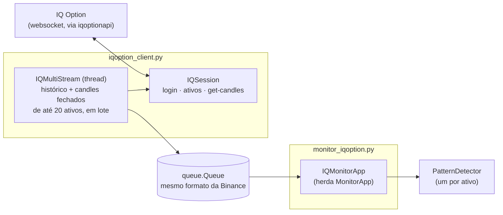

# Monitor de padrões: variação IQ Option

Variação do [monitor da Binance](../binance/README.md) que procura os mesmos padrões de `patterns/patterns.json` nos
ativos de opções binárias da **IQ Option** e gera alertas de **COMPRA (CALL)** ou **VENDA (PUT)**.

A janela, os padrões, os alertas e as regras de detecção são os mesmos do monitor da Binance. As diferenças
são o login, a lista de ativos e a origem dos candles.

> **Atenção**
> - A IQ Option **não tem API pública**. Este monitor usa a biblioteca não oficial
>   [`iqoptionapi`](https://github.com/Lu-Yi-Hsun/iqoptionapi), sem manutenção desde 2021. Ela pode parar
>   de funcionar a qualquer momento se a IQ Option mudar o protocolo.
> - É preciso entrar com **e-mail e senha da sua conta**. O uso de automações pode contrariar os termos de
>   uso da IQ Option; use por sua conta e risco (de preferência com a conta de treinamento).
> - A biblioteca conecta ao websocket da IQ Option **sem verificar o certificado SSL**.
> - O monitor só lê candles: não abre operações nem altera o saldo.

## Instalação

```bash
.venv/bin/pip install -r iqoption/requirements.txt
```

Isso instala as dependências do monitor da Binance mais a `iqoptionapi`, fixada num commit específico do
GitHub, e a `websocket-client 0.56` que ela exige.

## Como usar

Rode **a partir da raiz do projeto**, como módulo (`-m`):

```bash
.venv/bin/python -m iqoption.monitor_iqoption
```

Para não digitar as credenciais toda vez, você pode passá-las por variável de ambiente. Elas só servem para
preencher os campos; as credenciais nunca são gravadas em disco (as demais escolhas sim; veja
[Escolhas salvas](#escolhas-salvas-entre-uma-execução-e-outra)).

```bash
IQ_EMAIL='voce@email.com' IQ_PASSWORD='sua-senha' .venv/bin/python -m iqoption.monitor_iqoption
```

1. Preencha **E-mail** e **Senha** e clique em **Entrar** (ou pressione Enter no campo da senha).
2. Escolha o **Tipo** de ativo, como nas categorias da IQ Option: **Opcoes binarias** (padrão), **Blitz**,
   **Opcoes digitais**, **Forex**, **Criptomoedas** ou **CFD / Acoes** (ações, índices e commodities).
   Trocar o tipo encerra a procura em andamento e recarrega a lista. Se o ativo do campo **Par** não
   existir no novo tipo, o campo passa para o primeiro ativo da lista.
3. Depois do login, o histórico mostra `N ativos abertos (<tipo>)`, e a lista **Par** passa a mostrar
   **somente** os ativos abertos do tipo escolhido, com o nome como aparece na IQ Option (ex.: `EUR/USD`,
   `EUR/USD (OTC)`). A busca aceita variações: `EUR/USD`, `eurusd`, `EURUSD-OTC` e `eur/usd (otc)` encontram
   o ativo certo. Ativos fechados não aparecem e, se digitados, são recusados. A lista é atualizada a cada
   5 minutos, porque os mercados abrem e fecham (ex.: forex fecha no fim de semana e a versão OTC abre).
   Mudanças aparecem no histórico
   (`Lista atualizada: N ativos abertos (+x / -y)`), e se o ativo monitorado fechar aparece o aviso
   `<ATIVO> deixou de estar ativo`.
4. Em **Ativos**, escolha quantos ativos acompanhar ao mesmo tempo (1 a 20). Cada ativo ganha um cartão
   numerado com seu próprio campo de ativo; os cartões novos já vêm preenchidos com ativos abertos ainda não
   usados (o primeiro é `EUR/USD`). O mesmo ativo não pode ser escolhido duas vezes.
5. Escolha o **Tempo** (`1m`, `5m`, `15m`, `30m` ou `1h`; a IQ Option não tem candle de 3m). Ele vale para
   todos os ativos.
6. Clique em **Iniciar procura**. Com a procura ligada, trocar o ativo de um cartão ou a quantidade
   **só mexe nos ativos que entraram ou saíram**: os demais continuam sem reiniciar (sem perder um padrão
   que acabou de se formar), e o histórico mostra `Ativos alterados: -AUD/USD, +EUR/JPY (acompanhando N)`.
   Se o ativo escolhido for inválido ou repetido, aparece um aviso e o cartão volta ao ativo anterior.
   Trocar o **Tempo** ou o **Tipo** reinicia a procura de todos.
7. Um padrão que já estava formado quando o ativo entrou na procura (ao iniciar, ao trocar o ativo ou
   ao recarregar o histórico depois de uma reconexão) **gera alerta se o candle de entrada ainda estiver
   aberto**: `SINAL: ... | entrada 12:30 (em andamento, fecha em 85s)`. Ele conta no placar e o resultado
   (WIN/LOSS) é registrado quando a entrada fecha. Se a entrada já fechou, ele só aparece no histórico como
   `Historico (sem alerta)`, com o resultado. Os demais controles (alertas, som, placar, histórico) funcionam como no
   [monitor da Binance](../binance/README.md#como-usar).

### Escolhas salvas entre uma execução e outra

Ao fechar a janela (e ao iniciar uma procura), o monitor grava em
`~/.config/monitor_padroes/iqoption.json` o **Tipo**, a quantidade e os ativos de cada cartão, o **Tempo**,
as opções **Alertas ativos**, **Som** e **Exigir horario de entrada**, o tamanho da janela e se a procura
estava ligada. Ao abrir de novo, tudo volta como estava; o histórico avisa `Restaurados N ativo(s)`.

- **E-mail e senha não são gravados.** Continue usando `IQ_EMAIL`/`IQ_PASSWORD` se não quiser digitá-los.
- Se a procura estava ligada ao fechar, ela **é retomada sozinha** logo depois do login, assim que a lista
  de ativos chega, com os mesmos ativos.
- Se um ativo salvo não estiver aberto agora (ex.: forex no fim de semana), ele é trocado por um ativo
  aberto ainda não usado, com o aviso `Ativo N: <ativo> nao esta aberto em <tipo> agora; trocado por ...`.
- Os ativos de cartões escondidos (ao diminuir a quantidade) também ficam salvos e voltam ao aumentar.
- Para usar outro arquivo, defina `IQ_SETTINGS_FILE=/caminho/arquivo.json`. Para voltar ao padrão, apague o
  arquivo. Um arquivo inválido é ignorado.

### Cartões dos ativos

Cada ativo acompanhado tem um cartão com:

- o campo do ativo, a situação (`ao vivo`, `sem cotacao recente (ativo fechado?)` ou o erro) e o placar
  do ativo (`Sinais  W  L`, somado durante a sessão, mesmo que a procura seja reiniciada);
- a faixa dos últimos candles fechados, numerada como no monitor da Binance (gatilho 1..8 e entrada 9);
- o termômetro dos padrões (abaixo).

O cartão ganha borda amarela quando algum padrão se forma nele. Os cartões se distribuem em tantas colunas
quantas couberem na largura da janela (um cartão precisa de cerca de 540 px) e se reorganizam ao
redimensionar. A área dos cartões cresce até 55% da altura da janela; acima disso aparece uma barra de
rolagem (também funciona a roda do mouse sobre os cartões). O placar geral (`Sinais / Win / Loss`), a
contagem regressiva e o histórico continuam únicos, com o nome do ativo em cada mensagem. Se vários ativos
sinalizarem no mesmo candle, os alertas abrem em cascata para não se cobrirem.

### Termômetro dos padrões

Em cada cartão, uma linha por padrão mostra o quanto do gatilho (os 8 candles antes da
entrada) já se formou nos últimos candles fechados:

- os quadrados do gatilho ficam preenchidos com a cor de cada candle já formado; o próximo candle esperado
  aparece com contorno tracejado na cor que precisa ter;
- a barra do termômetro enche e esquenta conforme o padrão avança (azul até 50%, amarelo até 75%, laranja
  depois) e mostra a porcentagem;
- o texto diz quantos candles faltam e o horário previsto da entrada; com 8/8 aparece
  `FORMADO: COMPRA (CALL)` / `VENDA (PUT)` com o horário da entrada (o próximo candle).

Conta o maior trecho final dos candles fechados que repete o início do gatilho
(`PatternDetector.pattern_progress`). Se um candle sai diferente do esperado, o termômetro cai para o
trecho que ainda serve (às vezes 0). Com **Exigir horario de entrada** marcada, só conta se a entrada
prevista cair num minuto aceito (2/7); senão o padrão fica em 0%. O termômetro usa só candles fechados (a
IQ Option não envia o preço do candle em andamento).

## Arquitetura

```
binance_monitor/
├── iqoption/
│   ├── monitor_iqoption.py       # GUI: IQMonitorApp (herda MonitorApp) + login + AssetCard
│   ├── iqoption_client.py        # IQSession (conexão) + IQMultiStream (candles de até 20 ativos)
│   ├── requirements.txt
│   └── README.md                 # este documento
│
├── binance/monitor_patterns.py   # reaproveitado: MonitorApp
├── core/pattern_detector.py      # reaproveitado: detecção dos padrões
└── patterns/patterns.json        # mesmos padrões do monitor da Binance
```



### `iqoption_client.py`

- **`IQSession`**: a única conexão com a IQ Option (a biblioteca guarda o estado em variáveis globais, então
  não dá para ter duas). Um `lock` serializa as requisições entre a thread de ativos e a de candles.
  - `connect(email, senha)` / `reconnect()`: login, com limite de 40 s.
  - `get_assets(tipo)`: ativos de um tipo de `ASSET_TYPES`, com o `active_id` e se estão abertos. Cada tipo
    vem de uma consulta diferente da IQ Option:

    | Tipo na janela | Tipo na API | Consulta |
    |---|---|---|
    | Opcoes binarias | `binary` | `get_all_init_v2` da biblioteca (ativos `binary` + `turbo`) |
    | Blitz | `blitz` | `get_all_init_v2` da biblioteca (ativos `blitz`) |
    | Opcoes digitais | `digital` | `digital-option-instruments.get-underlying-list` v3.0 |
    | Forex | `forex` | `marginal-forex-instruments.get-underlying-list` v1.0 |
    | Criptomoedas | `crypto` | `marginal-crypto-instruments.get-underlying-list` v1.0 |
    | CFD / Acoes | `cfd` | `marginal-cfd-instruments.get-underlying-list` v1.0 (ações, índices, commodities) |

    Os pedidos de digitais, forex, cripto e CFD ficam em `UNDERLYING_REQUESTS`. Os da biblioteca para
    esses tipos (`get-underlying-list` v2.0 e `get-instruments` v4.0) são recusados hoje pela IQ Option com
    `Invalid contract`; os pedidos atuais foram identificados observando as mensagens do websocket.
    A resposta de todos chega como `underlying-list` (lista em `underlying` nas digitais e em `items`
    nos demais).

    Um ativo está aberto quando não está desabilitado nem suspenso e a hora do servidor está dentro de
    um dos horários de negociação (`schedule`, em segundos ou milissegundos), conforme `active_is_open`.
    Nas binárias o horário nem sempre vem, e sem horário o ativo conta como aberto. Nos demais tipos o
    horário é obrigatório: sem nenhum período, o ativo está fechado. Se o horário vier num formato
    desconhecido, vale só habilitado/suspenso. Se a consulta falhar, nada é mostrado (não há lista "de
    reserva" com ativos possivelmente fechados).
  - `_request(atributo, envio)`: faz as consultas de digitais, forex, cripto e CFD com **timeout** (as
    funções da biblioteca usam pedidos desatualizados e repetem o pedido para sempre).
  - `server_time()`: hora do servidor. Corrige um bug da biblioteca, que antes da primeira sincronização
    devolve uma data de 1970 (e fazia todos os ativos parecerem fechados logo após o login): se a hora
    estiver a mais de 1 h do relógio local, usa o relógio local.
  - `get_candles(active_id, size, count, end_time)`: reimplementa o `get_candles` da biblioteca com
    **timeout** (o original espera para sempre se a resposta não chegar). Funciona para todos os tipos,
    porque os candles são buscados pelo `active_id`.
- **`display_name(nome)`**: converte o nome da API para o da plataforma (`EURUSD-OTC` → `EUR/USD (OTC)`,
  `ATOMUSD-L` → `ATOM/USD (L)`). Pares de moedas conhecidos (`CURRENCIES`) e cripto cotadas numa moeda de
  `QUOTES` ganham a barra; o sufixo interno `-op` é removido; os demais nomes (ex.: ações como `AMAZON`,
  `AA:US`) ficam como vêm.
  - `get_candles_many(pedidos)`: busca os candles de vários ativos **de uma vez**. Envia todos os pedidos
    `get-candles` juntos, cada um com um `request_id` próprio (`monitor-N`), e reconhece cada resposta pelo
    `request_id`. Com isso, 20 ativos levam praticamente o tempo de um (a biblioteca guarda só a última
    resposta de candles, o que obrigaria a pedir um ativo por vez). As respostas são capturadas por um gancho
    no `on_message` do websocket, refeito a cada login. Se nenhuma resposta vier com o `request_id` (o
    servidor deixou de devolvê-lo), a sessão passa a pedir um ativo por vez com `get_candles`; isso só
    acontece se chegarem respostas de candles sem o `request_id`. Sem resposta nenhuma, o erro é
    `NoReplyError` (conexão caída) e o envio em lote continua ligado.
- **`IQMultiStream`** (thread): acompanha todos os ativos escolhidos numa única thread e envia eventos com
  o nome do ativo:
  1. no início, busca os últimos 30 candles de todos os ativos num único lote e envia cada um como histórico;
  2. pelo relógio do servidor, avisa a abertura de cada candle (para a contagem regressiva, comum a todos);
  3. 0,3 s depois de cada fechamento, busca num único lote os candles recém-fechados dos ativos que ainda
     não os receberam;
  4. um ativo sem candle novo (mercado fechado ou atraso do servidor) é tentado de novo com espera
     crescente (2 s, 4 s ... até 30 s), sem atrasar os outros; se faltarem mais de 3 candles (ex.: após uma
     reconexão), o histórico do ativo é recarregado sem alertas;
  5. `add_asset` / `remove_asset` (chamados pela GUI) incluem ou tiram um ativo com a procura ligada; a
     mudança é aplicada entre um lote e outro, e o ativo novo recebe o histórico no lote seguinte;
  6. se a conexão cair, reconecta com espera progressiva (1 s até 60 s). Conta como queda: o websocket
     fechado, um erro da biblioteca ao enviar o pedido ou **nenhum ativo responder** dentro de 15 s (conexão
     "meio aberta", em que o websocket parece aberto mas nada chega). Nesses casos a reconexão é feita mesmo
     que a biblioteca ainda diga que está conectada. Se a sessão (SSID) tiver expirado, a própria biblioteca
     faz o login de novo com o e-mail e a senha informados. Um ativo que responde com erro, com os outros
     funcionando, não derruba a conexão: só ele é tentado de novo mais tarde. A thread não termina por erro
     enquanto a procura estiver ligada.
- **`run_with_timeout`**: roda chamadas da biblioteca numa thread com limite de tempo, porque várias delas
  fazem esperas sem fim.

### `monitor_iqoption.py`

`IQMonitorApp` herda `MonitorApp` (de `binance/monitor_patterns.py`) e muda só o necessário. Cada ativo é um
`AssetCard` (cartão com campo do ativo, faixa de candles, termômetro e um `PatternDetector` próprio).

| Método | Mudança |
|---|---|
| `_build_ui` | monta login, controles, cartões, padrões e histórico (a janela base é dividida em `_build_controls`, `_build_info`, `_build_strip`, `_build_patterns` e `_build_log`) |
| `_build_asset_fields` | campos **Tipo** e **Ativos** no lugar do **Par** |
| `_build_cards` / `_layout_cards` / `_fit_cards_height` | área com rolagem; colunas conforme a largura e altura conforme a janela |
| `_load_symbols` | não carrega nada na abertura; os ativos vêm depois do login |
| `login` / `_process_iq_events` | login e lista de ativos numa thread, com uma fila própria; descarta listas de um tipo que já não está selecionado |
| `_show_symbols` / `_fill_default_assets` | lista de ativos em todos os cartões; preenche cartões vazios com ativos não usados |
| `_on_type_selected` / `_on_count_changed` / `_on_card_asset` | trocam tipo, quantidade ou ativo (reiniciando a procura, se ligada) |
| `SYMBOLS_LABEL` | vira uma property, para o histórico mostrar o tipo (`ativos abertos (Forex)`) |
| `start_search` | exige login, valida os ativos dos cartões (`_chosen_assets`) e cria um `IQMultiStream` |
| `_sync_stream` / `_attach` | com a procura ligada, inclui/remove no stream só os ativos que mudaram |
| `_log_history_signals` | padrão do histórico com a entrada ainda aberta vira sinal com alerta (`PatternDetector.follow` acompanha o resultado) |
| `_process_events` | eventos por ativo; cada cartão alterado é redesenhado uma vez por rodada |
| `_on_asset_signal` | sinal com o nome do ativo; alertas em cascata |
| `_save_settings` / `load_settings` | grava e restaura as escolhas da janela (`SETTINGS_FILE`) |
| `on_close` | salva as escolhas e também fecha a sessão da IQ Option |

Como depende de `MonitorApp`, mudanças futuras no monitor da Binance (nomes de métodos ou atributos como
`interval_box`, `detector`, `stream`) podem afetar esta variação.

## Diferenças em relação à Binance

| | Binance | IQ Option |
|---|---|---|
| Autenticação | nenhuma | e-mail e senha da conta |
| Ativos | pares SPOT (`BTC/USDT`) | binárias, blitz, digitais, forex, cripto e CFD, escolhidos no campo **Tipo** (`EUR/USD`, `EUR/USD (OTC)`) |
| Tempos | 1m, 3m, 5m, 15m, 30m, 1h | 1m, 5m, 15m, 30m, 1h |
| Candle fechado | enviado pelo WebSocket (`x = true`) | buscado ~0,3 s depois do fechamento |
| Biblioteca | oficial/pública (REST + WebSocket) | não oficial, sem manutenção |

## Solução de problemas

| Sintoma | Causa provável / solução |
|---|---|
| `Falha no login: {"code":"invalid_credentials"...}` | E-mail ou senha incorretos. |
| `Falha no login` mencionando verificação/2FA | Contas com autenticação em dois fatores não são suportadas pela biblioteca. |
| `Sem resposta da IQ Option em 40s` | Rede bloqueada ou mudança no protocolo da IQ Option que a biblioteca não acompanha. |
| `<ATIVO> sem cotacao recente (ativo fechado?)` | Mercado fechado (ex.: forex no fim de semana). Use a versão `-OTC` do ativo. |
| `Nao foi possivel carregar os ativos` | O login funcionou, mas a lista falhou. Uma nova tentativa é feita a cada 5 minutos; ou clique em **Entrar** de novo. |
| Padrão visível no gráfico do site, mas sem alerta | Se ele se formou **antes** de o ativo entrar na procura e o candle de entrada já fechou, não há alerta (a entrada já passou); ele aparece no histórico como `Historico (sem alerta)`, com o resultado. Se a entrada ainda estava aberta, há alerta, marcado como `em andamento`. Se aconteceu com a procura ligada, confira se **Exigir horario de entrada** está marcada (ela restringe a entrada aos minutos 2/7) e se o **Tipo** é o mesmo do gráfico: Forex e Blitz do mesmo par têm cotações ligeiramente diferentes, e um candle quase doji pode mudar de cor. |
| `<ATIVO> nao esta aberto na IQ Option` | O ativo está fechado ou suspenso agora. Escolha um da lista. Se no site ele aparece aberto, gere o diagnóstico abaixo. |

### Diagnóstico da lista de ativos

Se um ativo aparece aberto no site e fechado no monitor (ou o contrário), rode com `IQ_DUMP_ASSETS` para
gravar os dados brutos que a IQ Option enviou (só a lista de ativos e a hora do servidor; nada da conta):

```bash
IQ_DUMP_ASSETS=iqoption_ativos.json .venv/bin/python -m iqoption.monitor_iqoption
```

Depois do login, o arquivo `iqoption_ativos.json` traz os dados brutos do **tipo selecionado**
(`asset_type`), com os campos `enabled`, `is_suspended` e `schedule` usados para decidir se cada ativo está
aberto, além de `server_time`. Cada troca de tipo ou atualização da lista sobrescreve o arquivo.
| Lista de pares vazia | Faça login primeiro. |
