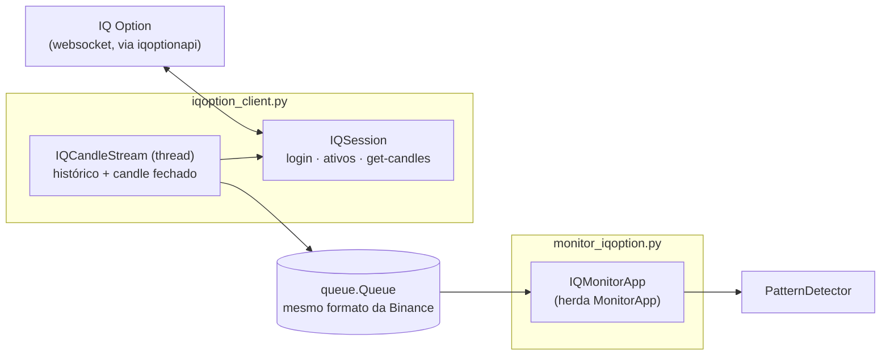

# Monitor de padrões: variação IQ Option

Variação do [monitor da Binance](../binance/README.md) que procura os mesmos padrões de `patterns/patterns.json` nos
ativos de opções binárias da **IQ Option** e gera alertas de **COMPRA (CALL)** ou **VENDA (PUT)**.

A janela, os padrões, os alertas e as regras de detecção são os mesmos do monitor da Binance. As diferenças
são o login, a lista de ativos e a origem dos candles.

> **Atenção**
> - A IQ Option **não tem API pública**. Este monitor usa a biblioteca não oficial
>   [`iqoptionapi`](https://github.com/Lu-Yi-Hsun/iqoptionapi), sem manutenção desde 2021. Ela pode parar
>   de funcionar a qualquer momento se a IQ Option mudar o protocolo.
> - É preciso entrar com **e-mail e senha da sua conta**. O uso de automações pode contrariar os termos de
>   uso da IQ Option; use por sua conta e risco (de preferência com a conta de treinamento).
> - A biblioteca conecta ao websocket da IQ Option **sem verificar o certificado SSL**.
> - O monitor só lê candles: não abre operações nem altera o saldo.

## Instalação

```bash
.venv/bin/pip install -r iqoption/requirements.txt
```

Isso instala as dependências do monitor da Binance mais a `iqoptionapi`, fixada num commit específico do
GitHub, e a `websocket-client 0.56` que ela exige.

## Como usar

Rode **a partir da raiz do projeto**, como módulo (`-m`):

```bash
.venv/bin/python -m iqoption.monitor_iqoption
```

Para não digitar as credenciais toda vez, você pode passá-las por variável de ambiente. Elas só servem para
preencher os campos; nada é gravado em disco.

```bash
IQ_EMAIL='voce@email.com' IQ_PASSWORD='sua-senha' .venv/bin/python -m iqoption.monitor_iqoption
```

1. Preencha **E-mail** e **Senha** e clique em **Entrar** (ou pressione Enter no campo da senha).
2. Escolha o **Tipo** de ativo, como nas categorias da IQ Option: **Opcoes binarias** (padrão), **Blitz**,
   **Opcoes digitais**, **Forex**, **Criptomoedas** ou **CFD / Acoes** (ações, índices e commodities).
   Trocar o tipo encerra a procura em andamento e recarrega a lista. Se o ativo do campo **Par** não
   existir no novo tipo, o campo passa para o primeiro ativo da lista.
3. Depois do login, o histórico mostra `N ativos abertos (<tipo>)`, e a lista **Par** passa a mostrar
   **somente** os ativos abertos do tipo escolhido, com o nome como aparece na IQ Option (ex.: `EUR/USD`,
   `EUR/USD (OTC)`). A busca aceita variações: `EUR/USD`, `eurusd`, `EURUSD-OTC` e `eur/usd (otc)` encontram
   o ativo certo. Ativos fechados não aparecem e, se digitados, são recusados. A lista é atualizada a cada
   5 minutos, porque os mercados abrem e fecham (ex.: forex fecha no fim de semana e a versão OTC abre).
   Mudanças aparecem no histórico
   (`Lista atualizada: N ativos abertos (+x / -y)`), e se o ativo monitorado fechar aparece o aviso
   `<ATIVO> deixou de estar ativo`.
4. Escolha o ativo e o **Tempo** (`1m`, `5m`, `15m`, `30m` ou `1h`; a IQ Option não tem candle de 3m).
5. Clique em **Iniciar procura**. Os demais controles (alertas, som, placar, histórico) funcionam como no
   [monitor da Binance](../binance/README.md#como-usar).

## Arquitetura

```
binance_monitor/
├── iqoption/
│   ├── monitor_iqoption.py       # GUI: IQMonitorApp (herda MonitorApp) + login
│   ├── iqoption_client.py        # IQSession (conexão) + IQCandleStream (candles em tempo real)
│   ├── requirements.txt
│   └── README.md                 # este documento
│
├── binance/monitor_patterns.py   # reaproveitado: MonitorApp
├── core/pattern_detector.py      # reaproveitado: detecção dos padrões
└── patterns/patterns.json        # mesmos padrões do monitor da Binance
```



### `iqoption_client.py`

- **`IQSession`**: a única conexão com a IQ Option (a biblioteca guarda o estado em variáveis globais, então
  não dá para ter duas). Um `lock` serializa as requisições entre a thread de ativos e a de candles.
  - `connect(email, senha)` / `reconnect()`: login, com limite de 40 s.
  - `get_assets(tipo)`: ativos de um tipo de `ASSET_TYPES`, com o `active_id` e se estão abertos. Cada tipo
    vem de uma consulta diferente da IQ Option:

    | Tipo na janela | Tipo na API | Consulta |
    |---|---|---|
    | Opcoes binarias | `binary` | `get_all_init_v2` da biblioteca (ativos `binary` + `turbo`) |
    | Blitz | `blitz` | `get_all_init_v2` da biblioteca (ativos `blitz`) |
    | Opcoes digitais | `digital` | `digital-option-instruments.get-underlying-list` v3.0 |
    | Forex | `forex` | `marginal-forex-instruments.get-underlying-list` v1.0 |
    | Criptomoedas | `crypto` | `marginal-crypto-instruments.get-underlying-list` v1.0 |
    | CFD / Acoes | `cfd` | `marginal-cfd-instruments.get-underlying-list` v1.0 (ações, índices, commodities) |

    Os pedidos de digitais, forex, cripto e CFD ficam em `UNDERLYING_REQUESTS`. Os da biblioteca para
    esses tipos (`get-underlying-list` v2.0 e `get-instruments` v4.0) são recusados hoje pela IQ Option com
    `Invalid contract`; os pedidos atuais foram identificados observando as mensagens do websocket.
    A resposta de todos chega como `underlying-list` (lista em `underlying` nas digitais e em `items`
    nos demais).

    Um ativo está aberto quando não está desabilitado nem suspenso e a hora do servidor está dentro de
    um dos horários de negociação (`schedule`, em segundos ou milissegundos), conforme `active_is_open`.
    Nas binárias o horário nem sempre vem, e sem horário o ativo conta como aberto. Nos demais tipos o
    horário é obrigatório: sem nenhum período, o ativo está fechado. Se o horário vier num formato
    desconhecido, vale só habilitado/suspenso. Se a consulta falhar, nada é mostrado (não há lista "de
    reserva" com ativos possivelmente fechados).
  - `_request(atributo, envio)`: faz as consultas de digitais, forex, cripto e CFD com **timeout** (as
    funções da biblioteca usam pedidos desatualizados e repetem o pedido para sempre).
  - `server_time()`: hora do servidor. Corrige um bug da biblioteca, que antes da primeira sincronização
    devolve uma data de 1970 (e fazia todos os ativos parecerem fechados logo após o login): se a hora
    estiver a mais de 1 h do relógio local, usa o relógio local.
  - `get_candles(active_id, size, count, end_time)`: reimplementa o `get_candles` da biblioteca com
    **timeout** (o original espera para sempre se a resposta não chegar). Funciona para todos os tipos,
    porque os candles são buscados pelo `active_id`.
- **`display_name(nome)`**: converte o nome da API para o da plataforma (`EURUSD-OTC` → `EUR/USD (OTC)`,
  `ATOMUSD-L` → `ATOM/USD (L)`). Pares de moedas conhecidos (`CURRENCIES`) e cripto cotadas numa moeda de
  `QUOTES` ganham a barra; o sufixo interno `-op` é removido; os demais nomes (ex.: ações como `AMAZON`,
  `AA:US`) ficam como vêm.
- **`IQCandleStream`** (thread): emite os mesmos eventos do `KlineStream` da Binance (`history`, `kline`,
  `status`), então `MonitorApp` os processa sem nenhuma mudança:
  1. busca os últimos 30 candles e os envia como histórico, junto com a diferença para o relógio do servidor;
  2. pelo relógio do servidor, avisa a abertura de cada candle (para a contagem regressiva);
  3. 0,3 s depois de cada fechamento, busca os últimos 3 candles e envia o recém-fechado;
  4. em caso de falha, reconecta com espera progressiva (1 s até 60 s) e recarrega o histórico.
- **`run_with_timeout`**: roda chamadas da biblioteca numa thread com limite de tempo, porque várias delas
  fazem esperas sem fim.

### `monitor_iqoption.py`

`IQMonitorApp` herda `MonitorApp` (de `binance/monitor_patterns.py`) e muda só o necessário:

| Método | Mudança |
|---|---|
| `_build_ui` | acrescenta a linha de login acima dos controles |
| `_load_symbols` | não carrega nada na abertura; os ativos vêm depois do login |
| `_build_ui` (tipo) | acrescenta o campo **Tipo** antes do **Par** |
| `login` / `_process_iq_events` | login e lista de ativos numa thread, com uma fila própria; descarta listas de um tipo que já não está selecionado |
| `_on_type_selected` | troca de tipo: para a procura e recarrega a lista |
| `SYMBOLS_LABEL` | vira uma property, para o histórico mostrar o tipo (`ativos abertos (Forex)`) |
| `start_search` | exige login e cria um `IQCandleStream` no lugar do `KlineStream` |
| `on_close` | também fecha a sessão da IQ Option |

Como depende de `MonitorApp`, mudanças futuras no monitor da Binance (nomes de métodos ou atributos como
`interval_box`, `detector`, `stream`) podem afetar esta variação.

## Diferenças em relação à Binance

| | Binance | IQ Option |
|---|---|---|
| Autenticação | nenhuma | e-mail e senha da conta |
| Ativos | pares SPOT (`BTC/USDT`) | binárias, blitz, digitais, forex, cripto e CFD, escolhidos no campo **Tipo** (`EUR/USD`, `EUR/USD (OTC)`) |
| Tempos | 1m, 3m, 5m, 15m, 30m, 1h | 1m, 5m, 15m, 30m, 1h |
| Candle fechado | enviado pelo WebSocket (`x = true`) | buscado ~0,3 s depois do fechamento |
| Biblioteca | oficial/pública (REST + WebSocket) | não oficial, sem manutenção |

## Solução de problemas

| Sintoma | Causa provável / solução |
|---|---|
| `Falha no login: {"code":"invalid_credentials"...}` | E-mail ou senha incorretos. |
| `Falha no login` mencionando verificação/2FA | Contas com autenticação em dois fatores não são suportadas pela biblioteca. |
| `Sem resposta da IQ Option em 40s` | Rede bloqueada ou mudança no protocolo da IQ Option que a biblioteca não acompanha. |
| `<ATIVO> sem cotacao recente (ativo fechado?)` | Mercado fechado (ex.: forex no fim de semana). Use a versão `-OTC` do ativo. |
| `Nao foi possivel carregar os ativos` | O login funcionou, mas a lista falhou. Uma nova tentativa é feita a cada 5 minutos; ou clique em **Entrar** de novo. |
| Padrão visível no gráfico do site, mas sem alerta | Se ele terminou **antes** de a procura começar, não há alerta (a entrada já passou); ele aparece no histórico como `Historico (sem alerta)`, com o resultado. Se aconteceu com a procura ligada, confira se **Exigir horario de entrada** está marcada (ela restringe a entrada aos minutos 2/7) e se o **Tipo** é o mesmo do gráfico: Forex e Blitz do mesmo par têm cotações ligeiramente diferentes, e um candle quase doji pode mudar de cor. |
| `<ATIVO> nao esta aberto na IQ Option` | O ativo está fechado ou suspenso agora. Escolha um da lista. Se no site ele aparece aberto, gere o diagnóstico abaixo. |

### Diagnóstico da lista de ativos

Se um ativo aparece aberto no site e fechado no monitor (ou o contrário), rode com `IQ_DUMP_ASSETS` para
gravar os dados brutos que a IQ Option enviou (só a lista de ativos e a hora do servidor; nada da conta):

```bash
IQ_DUMP_ASSETS=iqoption_ativos.json .venv/bin/python -m iqoption.monitor_iqoption
```

Depois do login, o arquivo `iqoption_ativos.json` traz os dados brutos do **tipo selecionado**
(`asset_type`), com os campos `enabled`, `is_suspended` e `schedule` usados para decidir se cada ativo está
aberto, além de `server_time`. Cada troca de tipo ou atualização da lista sobrescreve o arquivo.
| Lista de pares vazia | Faça login primeiro. |
